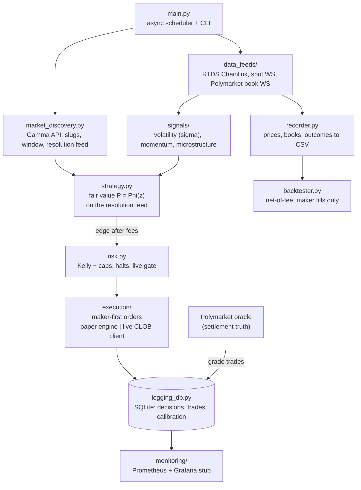

# BTC Up/Down Fair-Value Bot (Polymarket)

> **Disclaimer.** This is an educational and research project. It is not financial advice.
> Prediction markets and crypto are risky and you can lose all of the money you put in.
> Use this code at your own risk. All performance figures below come from paper trading
> unless stated otherwise, and the small live tests lost money.

## Summary

Polymarket lists short binary markets on Bitcoin: "Will BTC close at or above its opening
price in this 5-minute (or 15-minute, or 1-hour) window?" Most bots for these markets try
to predict BTC's direction with momentum indicators. Over a few minutes BTC is close to a
random walk, so that approach mostly trades noise. This bot treats each market as a binary
option instead. It computes the probability that the window closes up, using the
**same price feed the market settles on**, and posts passive limit orders only when that
probability differs from the order book by more than fees, spread and a model-error buffer.
The goal is positive expected value after fees, not a high win rate.

## Key features

- **Fair-value probability model.** `P(up) = Phi(z)` from realised move, calibrated
  volatility and time left in the window.
- **Oracle-aware feed routing.** Each market is priced and graded against the feed it
  actually resolves on (Chainlink BTC/USD stream or Binance BTC/USDT), detected from the
  market's rules at discovery. If that feed goes stale, the bot halts entries instead of
  falling back to a different price.
- **Maker-first execution.** Post-only GTC limit orders that pay zero fee. Crossing the
  spread (taker) is off by default because crypto markets carry Polymarket's highest
  taker fee.
- **Realistic paper engine.** A paper order fills only when the book trades through its
  price, with a queue penalty and a non-fill probability. No instant fills at mid.
- **Risk controls.** Fractional Kelly sizing under a hard dollar cap, concurrency and
  capital-at-risk limits, halt-streak isolation, an entry-price band, a book-staleness
  guard, a trend guard, and a live circuit breaker that stops new live entries if the
  first 20 live trades are not profitable.
- **Paper-validation gate.** Live trading needs three locks at once: `LIVE_MODE=true`,
  `LIVE_CONFIRM=YES`, and a `validation/paper_validation.json` record showing positive
  net EV per trade, calibrated probabilities and a real sample size.
- **SQLite trade store.** Every decision (including rejected ones, with the reason),
  every trade, and a calibration table of modelled probability vs actual outcome.
- **Honest backtester.** Net-of-fee only, maker fills only. A strategy that is positive
  before fees and negative after is reported as a FAIL. It can replay recorded order books
  and real oracle outcomes collected by the bot.
- **110 automated tests** covering the math, feeds, fees, execution, risk, settlement and
  the backtester.

## How the model works

Each market asks whether `close >= open` on its resolution feed.

```
P(up) = Phi(z)
z     = (drift_adj + realised_move) / (sigma * sqrt(remaining_frac))

realised_move   current resolution-feed price minus the window's opening reference
sigma           volatility over the window, from an EWMA estimator, scaled per window
remaining_frac  fraction of the window still to run
drift_adj       optional small signal nudges, clamped so they can move P by at most 0.05
Phi             standard normal CDF
```

Early in a window `remaining_frac` is close to 1, so `z` is small and `P` sits near 0.5:
the bot rarely trades. Near the close, even a modest move pushes `P` towards 0 or 1. That
is where any pricing edge over the book is largest.

A trade fires only when

```
|fair_value - executable_maker_price| > fee_estimate + half_spread + model_error_buffer
```

The Polymarket fee is modelled as `contracts * feeRate * p * (1 - p)`, which peaks at
`p = 0.5`, exactly where these contracts spend most of their life.

## Chainlink vs Binance: routing prices to the right oracle

A market pays out on one specific price source. Polymarket's 5m and 15m BTC markets settle
on the Chainlink BTC/USD data stream, not on Binance spot. The two can differ by a few
dollars at the resolution tick, and on a near-tie window a few dollars flips the outcome.

So the bot keeps two kinds of feed apart:

- **Resolution feed** (Chainlink via Polymarket's public RTDS socket, or Binance where a
  market settles on Binance). This is the only price used for `realised_move` and the
  opening reference.
- **Fast spot feed** (Binance/Coinbase websockets). Used only for volatility estimation
  and drift signals, never to decide who won.

**The bug I found.** Even with pricing routed correctly, settlement was graded off the
bot's own local copy of the Chainlink stream. On near-tie windows that local value
disagreed with what Polymarket actually paid out, so losses were recorded and alerted as
wins. I caught it by comparing the bot's Telegram alerts with Polymarket's results by hand.
The fix had three parts:

1. Grade every trade off Polymarket's own resolution (the oracle), in both paper and live
   mode, and use the local feed only as a last resort after a timeout.
2. Accept a decisive 0.99/0.01 price split as resolved, because Polymarket's `closed` flag
   lags the actual resolution.
3. A second bug hid the first fix: the Gamma API query for the result returned an empty
   list once a market flipped to `closed=true`, so the oracle was silently never consulted.
   Grading fell back to the local feed and mis-graded about 23% of near-tie 5m windows.
   The query now checks both the open and closed states.

## Architecture



Project layout:

```
bot/
  main.py               entry point: scheduler loop and CLI (run, discover, status, backtest)
  config.py             settings and env loading (pydantic-settings)
  models.py             shared dataclasses
  market_discovery.py   Gamma API discovery, exact-slug validation, feed and window detection
  strategy.py           fair-value engine
  risk.py               sizing, exposure caps, halt-streak isolation, live gate
  logging_db.py         SQLite trade and calibration store
  backtester.py         replay engine (synthetic or recorded books)
  recorder.py           records prices, book tops and real outcomes for backtesting
  alerts.py             optional Telegram alerts
  data_feeds/           Chainlink (RTDS and direct), spot websockets, Polymarket book websocket
  signals/              volatility, momentum, microstructure, funding, open interest
  execution/            order planning, paper engine, live CLOB client
  monitoring/           Prometheus endpoint and Grafana dashboard JSON
  tools/                read-only analysis: fill-conditional calibration, latency lead/lag
tools/
  calibrate_sigma.py    measures Phi(z) calibration on real Binance 1s data
tests/                  110 pytest tests
```

## Tech stack

Python (tested on 3.14), asyncio, `websockets`, `httpx`, `pydantic` and
`pydantic-settings`, `structlog`, SQLite (WAL mode), `prometheus-client`, `pytest` and
`pytest-asyncio`. Live trading uses `py-clob-client-v2`. No numpy, scipy or pandas: the
normal CDF uses `math.erf` and the backtester uses the standard library.

## Setup

```bash
git clone https://github.com/mikkylulz/Btc_trading_bot.git
cd Btc_trading_bot
python -m venv .venv
source .venv/bin/activate          # Windows: .venv\Scripts\activate
pip install -r requirements.txt
cp .env.example .env               # paper mode needs no keys
```

Paper mode, discovery and the backtester need no credentials. The Chainlink resolution
stream is read from Polymarket's public socket by default. Live trading needs Polymarket
CLOB credentials in `.env` plus `pip install py-clob-client-v2`. Every tunable in
`bot/config.py` can be overridden from `.env`.

## Run

```bash
python -m bot.main                 # paper trading loop (default)
python -m bot.main discover        # list active BTC markets and the feed each resolves on
python -m bot.main backtest        # backtest on synthetic prices
python -m bot.main backtest --books data/books.csv   # replay order books recorded by the bot
python -m bot.main status          # positions, net-of-fee PnL, calibration table
python -m tools.calibrate_sigma --window 5m --hours 8   # check sigma calibration
```

Set `RECORD_DATA=true` in `.env` to record prices, book tops and real outcomes under
`data/` for later backtests.

## Tests

```bash
pytest
```

110 tests run offline in about 10 seconds. They cover `Phi(z)` edge cases (including
ties and the end of the window), stale-feed halts with no spot fallback, the fee curve,
maker fill semantics, risk limits and halt isolation, the live gate, live order
reconciliation, oracle-based settlement, the recorder, and a backtest that is positive
before fees and negative after (it must report FAIL).

## Tuning order

1. Calibrate `sigma` per window until modelled `P` matches realised frequency.
2. Set the edge margin so net-of-fee EV is positive in backtest.
3. Tune the entry window for fill rate.
4. Only then consider turning on drift signals.

## Results so far (honest version)

- **Sigma calibration** on 8 hours of real Binance 1s data: the 5m model was overconfident
  (calibration error 0.134), fixed by doubling `sigma_scale` (error 0.044). 15m was already
  close (0.063). One sample, so it needs re-running across market regimes.
- **Edge audit:** comparing the model with recorded order books showed the plain GBM model
  is still overconfident, and the market's own prices forecast outcomes better than the
  model does. On this evidence the bot has **not** shown a reliable edge yet.
- **Live trading:** a few small live tests, all losing money (details below). The bot runs
  in paper mode, and the validation gate keeps it there until paper results justify going
  live.

## Lessons learned

- **Price against the oracle, and grade against the oracle.** Getting the pricing feed
  right was not enough. Settlement grading used a local copy of the same feed and still
  disagreed with the real payout on near-tie windows. Anything that decides a win or loss
  now comes from Polymarket's own resolution.
- **Silent fallbacks are the worst bugs.** Both oracle bugs failed quietly and fell back to
  a "good enough" value. The bot now refuses to price on a stale feed rather than
  substituting one.
- **Paper engines lie unless you make them pessimistic.** Paper fills only happen when the
  book trades through the price, with queue penalties and random non-fills.
- **Live is different from paper.** The first live run drained the small test wallet
  through unbounded order laddering: the bot had no live fill detection, so it never saw
  its own fills and kept posting. The fixes: a live fill reconciler, confirmed cancels only,
  Polymarket's minimum order size, and a circuit breaker on the first 20 live trades.
- **Grading bugs inflate results.** A later live test recorded three trades as a +$5.04 net
  win when the real result was -$7.57. Mis-graded rows were tagged and excluded from stats.
- **A stop-loss can cost more than it saves on a binary.** Over 24 paper exits, the
  probability-space stop lost $21.88 more than holding to resolution. It is now off.
- **The model assumes zero drift.** In a sustained move it kept buying the cheap reversal
  side and losing, so a trend guard now blocks bets against a strong recent drift.
- **Long-running processes need bounded memory.** One corrupt millisecond timestamp stopped
  the price buffer from pruning, causing a MemoryError after days. The buffer now has a hard
  size cap and normalises timestamps.
- **Win rate is not the target.** Breakeven win rate on a binary is the entry price plus
  fees. The dashboards track net-of-fee EV per trade and calibration instead.

## License

MIT. See [LICENSE](LICENSE).
